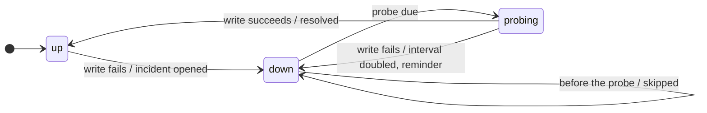

A failing sink does not take the program or the other sinks with it. Its slot goes `down`, skips records until the next probe, and raises one incident on the alarm route, not one per record. Another sink takes the incident; when the sink works again, the recovery is told too.

## Policies

`on_fail` on a slot decides what a failure does.

| Policy | Direct failure | Background failure | Health |
|:--|:--|:--|:--|
| `panic` | raised in the caller | one line on standard error, one second for other sinks to flush, exit code 70 | not tracked; every failure raises |
| `ignore` | counted | counted | tracked, nothing told |
| an alarm | an incident on the alarm route | the same | tracked, told once per failure |

## Health



The probe interval starts at `probe`, doubles on each failed probe up to 5 minutes, and resets on recovery. A `reminder` goes out when the alarm's `remind` has passed since it last told.

## Alarm route

An alarm is a list of tiers. For an incident it leaves out the failing sink, then tries each tier in turn: `*` stands for every sink on the log route, sinks already tried or resting are left out, and the rest are written at once, bypassing their queues. The first success ends the walk. When no tier takes it, the alarm's own `on_fail` applies: `ignore` drops it, `panic` exits.

```yaml
sinks:
  - { kind: loki, url: "http://alloy:3100/loki/api/v1/push", on_fail: ops }
  - { kind: mail, name: oncall, alarm_only: true, host: smtp.example.org, to: [ops@example.org] }
alarms:
  ops: { tiers: [[oncall], [stderr]], remind: 30m }
```

An incident is a record at `error` for `opened` and `reminder` and at `info` for `resolved`, with target `serlog` and the fields `sink`, `kind`, `phase`, `failures`, `skipped`, `dropped` and `since`. Two rules stop loops: a sink that fails while delivering an incident rides in that incident, and records made while a sink or processor runs are dropped and counted as suppressed.

## Status

<Langs>
<Rust>

```rust
for s in serlog::status() {
    println!("{}: {} since {:?}, {} skipped", s.name, s.health, s.since, s.skipped);
}
```

</Rust>
<Python>

```python
for s in serlog.status():
    print(f"{s.name}: {s.health} since {s.since}, {s.skipped} skipped")
```

</Python>
<TypeScript>

```ts
for (const s of serlog.status()) console.log(`${s.name}: ${s.health} since ${s.since}, ${s.skipped} skipped`);
```

</TypeScript>
<Java>

```java
for (var s : Serlog.status()) IO.println(s.name() + ": " + s.health().id() + " since " + s.since() + ", " + s.skipped() + " skipped");
```

</Java>
<Go>

```go
for _, s := range serlog.Statuses() {
	fmt.Printf("%s: %s since %v, %d skipped\n", s.Name, s.Health, s.Since, s.Skipped)
}
```

</Go>
</Langs>
