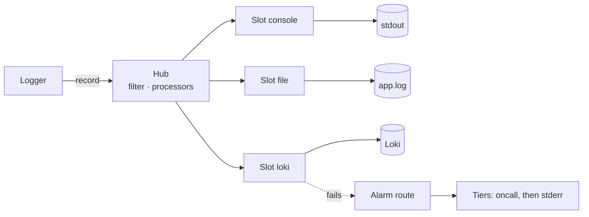

serlog sends each record to any number of sinks, and every sink has its own filter, layout, queue, retries and failure policy. The model, the config format and the output are the same in all five languages; pick yours with the language button, and every example on every page follows.

## Install

<Langs>
<Rust>

```bash
cargo add serlog --features file,loki,config
```

The console sink is on by default. `file`, `loki`, `mail` and `config` add the other sinks and config files; `full` turns on everything.

</Rust>
<Python>

```bash
pip install serlog            # config files in YAML: pip install "serlog[yaml]"
```

Python 3.15 or later.

</Python>
<TypeScript>

```bash
npm install serlog            # YAML: npm install yaml; TOML: smol-toml; mail: nodemailer
```

Node 26 or later, ESM and CommonJS.

</TypeScript>
<Java>

```xml
<dependency>
  <groupId>io.github.leoheco</groupId>
  <artifactId>serlog</artifactId>
  <version>0.1.0</version>
</dependency>
```

Java 25 or later. Config files need Jackson 3 for their format; the mail sink needs `org.eclipse.angus:angus-mail`.

</Java>
<Go>

```bash
go get github.com/LeoHeco/ServerLog/go
```

Go 1.27 or later.

</Go>
</Langs>

## First record

With no set-up at all, `info` and above go to standard output.

<Langs>
<Rust>

```rust
serlog::info!(mirror = "debian", files = 42, "synced");
```

</Rust>
<Python>

```python
import serlog

serlog.info("synced {} files", 42, mirror="debian")
```

</Python>
<TypeScript>

```ts
import * as serlog from "serlog";

serlog.info({ mirror: "debian" }, "synced %d files", 42);
```

</TypeScript>
<Java>

```java
import io.github.leoheco.serlog.Serlog;

Serlog.info("synced {} files", 42);
```

</Java>
<Go>

```go
import serlog "github.com/LeoHeco/ServerLog/go"

serlog.Info("synced files", "n", 42, "mirror", "debian")
```

</Go>
</Langs>

## How the parts fit



A logger makes records; the hub filters and processes them and hands them to every slot. A slot wraps one sink and does everything around it: its own filter and processors, the layout, the queue, retries and health. When a sink fails, its slot raises one incident on the alarm route, which tries other sinks tier by tier until one takes it.

## Next

- [Get started](start): set-up from code or a file, several sinks, records with fields.
- [Config files](config): every key, environment variables, reloading.
- [Write your own sink](guides/phone): a phone sink from definition to use.
