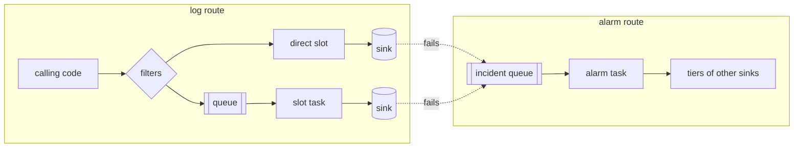

The same parts exist in every language; only the spelling follows each language's conventions, so `max_size` in a config file is `maxSize` in TypeScript and Java.

## Parts

| Part | Does | Does not |
|:--|:--|:--|
| Logger | makes records with a target and bound fields; skips argument evaluation below the level | decide where records go |
| Record | level, target, message, typed fields, tags, caller, thread, span chain, time, sequence number | know how it is shown |
| Filter | admits or rejects by target directives and a message regex | change records |
| Processor | adds fields, changes the message, or drops the record | write anything |
| Layout | turns a record into text | know where the text goes |
| Sink | delivers entries somewhere and reports what went wrong | queue, retry, alarm or lay out |
| Slot | wraps one sink: name, filter, processors, layout, queue, retries, health, failure policy | know how the sink writes |
| Hub | global filter, scope fields, global processors, the slot table | anything about one sink |
| Alarm | chooses the tiers for an incident | touch health |

A sink receives an entry: the record plus the line its slot's layout makes of it, rendered on first use. A record going to several slots with the same layout is rendered once.

## Two routes

| Route | Producer | Queue | Consumer |
|:--|:--|:--|:--|
| log | the calling code | one per queued slot | one background task per queued slot, writing in batches |
| alarm | a failing slot | one, process-wide | one alarm task, one incident at a time |

Queues, their tasks and the alarm task start on first use.

## Levels

| Level | Value | Colour |
|:--|:--|:--|
| `trace` | 10 | cyan |
| `debug` | 20 | magenta |
| `info` | 30 | green |
| `warn` | 40 | yellow |
| `error` | 50 | red |
| `fatal` | 60 | white on red |

Names are case-insensitive; `warning` means `warn`, `critical` means `fatal`, and a number from 0 to 255 is a level by value. Custom levels have a lower-case name, a value and a colour, and work in filters, calls and layouts alike.

## Defaults

| Setting | Default |
|:--|:--|
| sinks | a console on standard output, `info` and above |
| name | kind and number: `file-1`, `file-2` |
| `on_fail` | the `default` alarm: `tiers: [[stderr]]`, `remind: 1h` |
| queue | console, file and memory write directly; loki 8192 records, 1000 a batch or 1 s; mail 1024, 1000 a batch or 60 s |
| retries | 0 when direct; 3 behind a queue, pausing 1, 2, 4 s |
| probe | 5 s, doubling on each failed probe, at most 5 min |
| network timeout | 10 s |
| flush at exit | at most 5 s |

`stderr` is a reserved console sink on standard error that only the alarm route uses; a sink named `stderr` replaces it.
